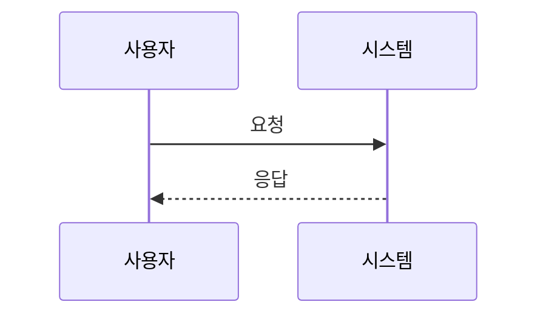

# F-000 [기능명] 설계

<!-- 큰 기능에만 쓴다. 코드를 읽으면 알 수 있는 내용은 적지 않는다. -->

## 1. 접근 방식
<!-- 어떻게 구현할지 요약. 어느 요구사항(F-000-Rn)을 어떻게 충족하는지 연결한다. -->

## 2. 구성 요소와 변경 범위
<!-- 새로 만들거나 고칠 모듈·파일. -->
| 구성 요소 | 변경 내용 | 관련 요구사항 |
|---|---|---|
|  |  |  |

## 3. 데이터 모델
<!-- 새로 생기거나 바뀌는 데이터 구조, 저장 방식. -->

## 4. 인터페이스
<!-- API, 함수 시그니처, 이벤트, 파일 형식 등 외부와 맞닿는 부분. -->

## 5. 흐름
<!-- 필요할 때만. 화살표는 사람이 코드와 대조해 확인한다. -->

## 6. 검토한 대안
| 대안 | 채택하지 않은 이유 |
|---|---|
|  |  |

<!-- 되돌리기 어려운 선택이면 ADR로 남기고 여기에는 링크만 둔다. -->

## 7. 위험과 미확정 사항
- [확인 필요] 
