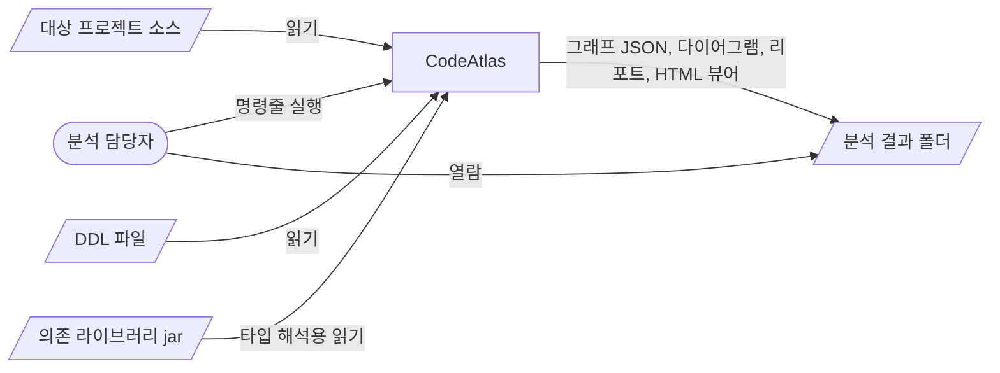
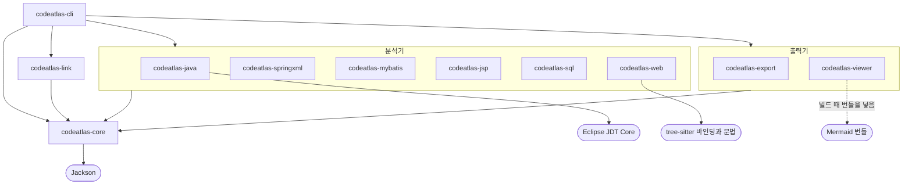

# 아키텍처: CodeAtlas

<!-- arc42 축약본. 절 번호는 arc42 원본 번호를 따른다.
     생략한 절(2 제약, 6 런타임 뷰, 7 배포 뷰, 12 용어집)은 필요해지면 추가한다.
     에이전트에게: 1, 4, 10, 11절의 의도는 코드에서 알아낼 수 없다. 사람에게 묻거나 [확인 필요]로 둔다. -->

## 1. 목표와 품질 목표
소스만 읽어서 Java·MyBatis·SQL·프로시저·화면 스크립트의 관계를 하나의 그래프로 만들고, 거기서 ERD·클래스 다이어그램·콜트리를 뽑는 정적 분석 도구다. 자세한 목표는 [PRD](prd.md)를 본다.

품질 목표는 에이전트가 제안한 초안이다. [확인 필요] 사용자 검토.

| 우선순위 | 품질 목표 | 시나리오 |
|---|---|---|
| 1 | 정직성 | 해석하지 못한 호출이나 테이블 참조는 결과에서 빠지지 않고 미해결로 표시된다. 추론한 관계는 근거 위치가 붙는다. |
| 2 | 내결함성 | 문법 오류가 있는 파일이나 모르는 구문이 있어도 그 파일(또는 구문)만 실패로 기록하고 나머지 분석을 끝낸다. |
| 3 | 확장성 | 새 언어나 SQL 방언의 분석기를 기존 분석기 코드를 고치지 않고 추가한다. |

## 3. 컨텍스트와 범위

| 상대 | 주고받는 것 | 방식 |
|---|---|---|
| 대상 프로젝트 소스 | Java, 매퍼 XML, Spring XML, SQL, JS/TS, JSP | 파일 읽기 전용 |
| DDL 파일 | 테이블·프로시저 정의 | 파일 읽기 전용 |
| 의존 jar | 타입 해석용 클래스 정보 | 파일 읽기 전용, 없어도 동작 |
| 분석 결과 폴더 | graph.json, 다이어그램, CSV, HTML | 파일 쓰기 |

## 4. 해결 전략
- 도구는 Java 21과 Maven 멀티모듈로 만든다. ([ADR-0002](decisions/0002-implement-in-java-21-maven.md))
- Java는 Eclipse JDT Core로 파싱하고 바인딩을 해석한다. ([ADR-0003](decisions/0003-use-jdt-core-for-java.md))
- SQL, DDL, 프로시저는 오류를 허용하는 파서를 직접 만든다. ([ADR-0004](decisions/0004-hand-written-tolerant-sql-parser.md))
- JavaScript 계열은 tree-sitter 문법으로 파싱한다. ([ADR-0005](decisions/0005-use-tree-sitter-for-javascript.md))
- 모든 분석기는 공통 그래프 모델에만 쓰고 서로를 직접 참조하지 않는다. 분석기 사이의 연결은 노드 ID 규칙, 내장 소스 전달, 별도 링커가 맡는다. 결과는 JSON 파일로 저장한다. ([ADR-0006](decisions/0006-graph-json-and-static-viewer.md))
- 다른 언어 안에 박힌 코드(매퍼 XML·애너테이션·XML 빈의 SQL, JSP의 인라인 스크립트)는 내장 소스로 넘기고 분석기끼리 직접 호출하지 않는다. ([ADR-0007](decisions/0007-pass-embedded-code-via-embedded-sources.md))
- SQL은 DB 객체를 스키마 없는 이름의 `db:table:`로 참조하고, 뷰·시노님·루틴과 맞추는 일은 링커가 한다. ([ADR-0008](decisions/0008-reference-tables-by-name-and-normalize-in-linker.md))
- Lombok이 만들 멤버는 애너테이션 처리기를 돌리지 않고 Java 분석기가 합성한다. ([ADR-0009](decisions/0009-synthesize-lombok-members-without-annotation-processing.md))
- 방언별로 여러 벌인 매퍼와 SQL 스크립트는 한 벌만 쓰고, 대상 방언(Oracle, DB2)을 먼저 고르는 순위로 고른다. ([ADR-0010](decisions/0010-select-one-dialect-variant-by-target-first-ranking.md), 제안 상태: 소유자 승인 전)
- 한 노드에서 여러 대상으로 퍼지는 엣지는 그래프에 전부 남기고, 읽는 쪽(export, viewer)이 경로의 수신자 문맥으로 좁힌다. ([ADR-0011](decisions/0011-keep-fanout-edges-and-narrow-in-consumers.md), 제안 상태: 소유자 승인 전)

실제로 쓴 라이브러리와 버전 (pom에서 확인, 2026-10-11)

| 용도 | 라이브러리 | 버전 | 쓰는 모듈 |
|---|---|---|---|
| Java 파싱·바인딩 | `org.eclipse.jdt:org.eclipse.jdt.core` | 3.47.0 | codeatlas-java |
| JS·TS 파싱 | tree-sitter-ng 바인딩 `io.github.bonede:tree-sitter` | 0.26.6 | codeatlas-web |
| | 문법 `io.github.bonede:tree-sitter-javascript` / `tree-sitter-typescript` / `tree-sitter-tsx` | 0.25.0 / 0.23.2 / 0.23.2 | codeatlas-web |
| 뷰어의 다이어그램 | `org.webjars.npm:mermaid` (빌드 때 `mermaid.min.js`만 풀어 뷰어 HTML에 넣는다. 런타임 의존이 아니다) | 11.17.2 | codeatlas-viewer |
| graph.json 읽고 쓰기 | `com.fasterxml.jackson.core:jackson-databind` | 2.22.3 | codeatlas-core |
| 테스트 | JUnit Jupiter, AssertJ | 5.14.4, 3.27.7 | 전부 |

- 외부 라이브러리는 위 표가 전부다. SQL·DDL 파서와 JSP 스캐너는 직접 만들었고, 매퍼 XML과 Spring XML은 JDK에 들어 있는 XML 파서(SAX, StAX)로 읽는다(sql, mybatis, springxml, jsp, link, export 모듈의 의존은 core뿐이다).
- ADR-0005의 확인 항목 결과: tree-sitter-ng 바인딩으로 JS, JSX, TS, TSX를 파싱한다. 네이티브 라이브러리는 바인딩 jar의 `lib/` 리소스에 들어 있고 실행 때 임시 파일로 풀어 올린다(네트워크 불필요, 실행 jar 하나에서도 같다). 지원 범위는 바인딩이 싣고 있는 Linux(glibc) x86_64·aarch64, macOS x86_64·aarch64, Windows x86_64다([F-010 spec](specs/F-010-javascript/spec.md) 5절).

## 5. 빌딩 블록 뷰 (레벨 1)
<!-- 아래 그림의 화살표는 각 모듈 pom.xml의 의존(compile 범위)과 대조했다(2026-10-11). 의존을 바꾸면 그림도 고친다. -->

- 화살표는 Maven 의존이다. core가 아닌 모듈끼리는 서로 의존하지 않고, cli만 전부(core 포함)에 의존한다. 분석기 묶음과 출력기 묶음에서 나가는 화살표는 그 안의 모듈 각각에 해당한다.
- cli는 분석기·링커·출력기의 클래스를 직접 부르지 않고 `ServiceLoader`로 찾는다. 예외는 조회용 하위 명령으로, export 모듈의 조회 API(`io.codeatlas.export.*`)를 직접 부른다.
- 실행 순서는 의존 방향과 다르다: 스캔(core) → 분석기(order 100: java, springxml, mybatis, jsp → order 200: sql, web) → 링커(link) → 마무리 → 저장 → 출력기(export, viewer).

| 블록 | 책임 | 코드 위치 |
|---|---|---|
| codeatlas-core | 그래프 모델과 ID 규칙(`Ids`), 파일 스캐너·분류·인코딩 판별, 분석기·링커·출력기 SPI와 내장 소스 전달, 파이프라인(전체 실행, 출력기 없이 실행, 저장된 그래프로 출력기만 실행), `graph.json` 읽고 쓰기(분석할 때 준 옵션을 `project.options`에 함께 저장), 테스트용 가짜 프로젝트(`TestProject`). 마무리 단계가 만든 미해결 노드에 분류를 채우고, 힙이 모자라면 어느 단계의 무엇을 처리하던 중이었는지를 담은 오류(`AnalysisOutOfMemoryError`)로 바꿔 던진다 | `codeatlas-core/` |
| codeatlas-java | Java 구조(타입·멤버·상속·연관·의존, Lombok이 만들 멤버의 합성, 출처 기준 JDK 타입 판정), 콜 그래프(호출·생성·오버라이드·필드 접근. JDT가 해석하지 못한 호출은 모든 파일을 본 뒤 합성 멤버 등에서 다시 찾는다), 애너테이션 기반 Spring(빈, 주입(Lombok 생성자 주입 포함), 엔드포인트(경로의 프로퍼티 자리표시자는 원문 그대로), 뷰 이름(헬퍼 메서드가 돌려주는 것 포함), 서블릿 API·Spring Security·Shiro의 redirect·forward 경로, 뷰 이름·redirect·forward의 호출 지점, `@ModelAttribute` 메서드의 선행 호출, 필터·인터셉터 표시, `SqlSession` 호출(구문 ID의 리터럴 접두, 라이브러리 메서드에 인자로 넘긴 구문 ID 문자열 포함)), 한 가지 꼴의 리플렉션 호출 추론, Java 설정 Spring Batch. 애너테이션 SQL(`@Select` 등)은 구문 노드를 만들고 본문을 내장 소스로 넘긴다 | `codeatlas-java/` |
| codeatlas-springxml | Spring XML 빈 설정(빈, 주입, MyBatis·뷰 리졸버 설정 속성), `<mvc:view-controller>`(핸들러 없이 뷰를 그리는 엔드포인트), Spring Batch XML 잡 설정(잡, 스텝, 흐름, 구성 요소), `web.xml`의 서블릿 설정. 리더·라이터 빈의 인라인 SQL은 내장 소스로 넘긴다 | `codeatlas-springxml/` |
| codeatlas-mybatis | 매퍼 XML의 구문·조각·resultMap·타입 별칭 해석, 동적 SQL 전개(값 비교 `<if>`는 값마다 전개본을 나눈다), 방언별로 여러 벌인 매퍼 가운데 한 방언 고르기(프로젝트 설정 파일에서 방언 읽기 포함. 다른 방언에서 보충한 구문은 표시한다). SQL 본문은 전개본마다 내장 소스로 넘기고 `${…}` 자리의 원문을 치환 목록으로 함께 넘긴다 | `codeatlas-mybatis/` |
| codeatlas-jsp | JSP·JSPF·태그 파일과 HTML 파일의 포함, 폼·링크 요청(HTML의 Thymeleaf 링크 식과 조각 포함 포함), 외부 스크립트 참조, 페이지의 폼 표(이름·ID와 메서드)와 필드 표(hidden·text input에 든 서버 경로), action 없는 폼의 요청, 접두사 있는 커스텀 태그의 URL 속성, 레이아웃 관계(SiteMesh 데코레이터, Tiles 정의: 설정 XML을 읽는다). 인라인 스크립트와 이벤트 핸들러는 JSP 요소를 치환해 내장 소스로 넘긴다. 벤더 폴더의 페이지는 노드만 만들고 건너뛴다(web과 같은 경로 규칙을 따로 구현한다) | `codeatlas-jsp/` |
| codeatlas-sql | SQL·DDL 파서와 테이블·컬럼·조인·호출 추출, DDL 객체(테이블, 뷰, 시퀀스, 시노님, 루틴·패키지 헤더) 등록(같은 테이블의 정의가 여러 파일에 있으면 한 파일의 것만 쓴다. 방언별 여러 벌이면 프로젝트 전체로 한 방언을 고른다), 데이터 적재 파일의 리터럴 INSERT 묶기, DDL에 없는 컬럼 참조와 DB 사전 뷰의 표시, SQL 내장 소스 분석. 대상 방언은 Oracle과 DB2이고 그 밖의 방언 표기는 진단 없이 넘기는 수준으로만 읽는다. 프로시저 본문 파서(PL/SQL, DB2 SQL PL): 프로시저·함수·패키지 본문·트리거·익명 블록의 구조를 파싱해 본문 안의 SQL 구문, 루틴 간 호출, 동적 SQL 지점을 기록한다(패키지 `routine`, `parser.RoutineParser`) | `codeatlas-sql/` |
| codeatlas-web | JS·JSX·TS·TSX의 함수, 호출, import, HTTP 요청 추출. JS 내장 소스 분석. 클라이언트 라우터의 화면 전환과 JSX의 HTML 요소가 가리키는 서버 경로. 벤더(서드파티) 스크립트 판정(경로, 알려진 라이브러리 이름, 생성물, 머리 주석의 라이선스 문구와 프로젝트 정합성 검사)과 건너뛰기. 다른 스크립트의 전역 함수는 두 스크립트를 함께 싣는 페이지(레이아웃으로 묶인 페이지 포함)가 확인될 때 잇고, 근거가 없으면 정의가 프로젝트에 하나뿐일 때만 추론으로 잇는다 | `codeatlas-web/` |
| codeatlas-link | 링커 여덟 개(실행 순): 외부 참조 표시(선언되지 않은 Java 참조에 `external`), DB 객체 정규화(뷰·시노님·루틴), 매퍼 메서드↔구문(상위 인터페이스에서 물려받은 매퍼 메서드, 구문 ID의 접두로 찾은 구문, 인자로 넘긴 구문 ID 포함), 뷰 이름↔JSP와 redirect·forward(뷰 이름 접두사와 서블릿 API 경로, Tiles 정의, 동적 디렉터리 뷰 이름, 핸들러 없는 엔드포인트의 뷰), 요청↔엔드포인트(프로퍼티 자리표시자 치환, 상대 URL은 그 페이지를 그리는 핸들러의 경로 기준, 끝 슬래시, 메서드 후보, action 없는 폼, 모듈 경계: 같은 모듈의 선언 우선, 서로 다른 웹앱 모듈끼리는 잇지 않음), 빈 참조 풀기(자리표시자가 든 빈 이름 포함), 주입 후보 좁히기, 테이블 관계 추론(상수로 채운 복합 키 포함. 뷰가 낀 조인은 옵션으로만. 방향을 정하지 못하면 DDL 외래 키의 방향을 따른다). 프로젝트의 properties·yml 값으로 자리표시자를 푸는 공용 헬퍼를 둔다 | `codeatlas-link/` |
| codeatlas-export | 조회 API(ERD, 테이블 명세, 클래스 다이어그램, 콜트리, 영향도, CRUD 매트릭스, 노드 검색, 요약 리포트)와 표준 산출물을 쓰는 출력기. 그래프를 따라가는 규칙(구현 전개, 주입·수신자 문맥으로 좁히기, 트리거, 모듈 경계)은 `FlowNavigator` 한 곳에 있다. 큰 산출물은 나눈다(엔드포인트 콜트리는 컨트롤러별, ERD는 영역별) | `codeatlas-export/` |
| codeatlas-viewer | 그래프와 Mermaid 번들을 넣은 단일 HTML 뷰어(`viewer.html`)를 쓰는 출력기 | `codeatlas-viewer/` |
| codeatlas-cli | 명령줄 진입점(`analyze`, `summary`, `export`와 조회용 하위 명령 `erd`, `classdiagram`, `calltree`, `impact`, `crud`, `find`, `report`), 분석 요약 끝의 힌트, 메모리 부족 안내(종료 코드 3), 실행 jar 패키징, 실행 jar·샘플 프로젝트 통합 테스트 | `codeatlas-cli/` |

## 8. 횡단 개념
- 그래프 계약: 노드·엣지 종류, ID 규칙, 속성 키는 [F-001 설계](specs/F-001-analysis-pipeline/design.md)에 있다. 모든 모듈이 이것만 공유한다.
- 신뢰도: 모든 엣지는 `RESOLVED`(확정), `INFERRED`(추론), `UNRESOLVED`(미해결) 중 하나다.
- 미해결: 해석하지 못한 참조는 `unresolved:<분류>:<원문>` 노드로 가는 엣지로 남긴다. 분류 목록은 계약 3.6에 있다. 끝점 노드가 없는 엣지는 파이프라인의 마무리 단계가 미해결로 바꾼다.
- 진단: 파싱 실패, 미해결 참조, 지원하지 않는 구문은 진단 목록에 쌓이고 `diagnostics.md`와 `report.md`로 나온다. 코드와 심각도는 계약 3.7에 있다.
- 내장 소스 전달: 다른 언어 안에 박힌 코드(매퍼 XML·애너테이션·XML 빈의 SQL, JSP의 인라인 스크립트와 이벤트 핸들러)는 생산자 분석기가 주인 노드를 만들고 본문을 컨텍스트에 `EmbeddedSource`로 등록하면, 뒤에 도는 소비자 분석기(sql, web)가 꺼내 분석해 주인 노드에 엣지와 속성을 덧붙인다. 생산자와 소비자는 서로를 호출하지 않는다. 본문 안의 자리표시자(`__DYNAMIC__`, `__JSP_EXPR__`) 약속은 계약 3.9에 있다. ([ADR-0007](decisions/0007-pass-embedded-code-via-embedded-sources.md))
- DB 객체 참조와 정규화: SQL 분석은 테이블인지 뷰·시노님인지 가리지 않고 스키마를 뺀 이름의 `db:table:`로 참조한다. 링커의 첫 단계(DB 객체 정규화)가 그 참조를 뷰, 시노님의 최종 대상, 정의된 루틴으로 합친다. ([ADR-0008](decisions/0008-reference-tables-by-name-and-normalize-in-linker.md))
- 루틴 본문: 프로시저·함수·트리거가 테이블을 읽고 쓰는 관계는 `루틴 -CONTAINS→ 구문 -READS/WRITES→ 테이블`로, 루틴 간 호출은 `루틴 -CALLS→ 루틴`으로 남는다. 동적 SQL은 식이 문자열 리터럴로 완전히 풀릴 때만 분석하고, 풀리지 않으면 리터럴 조각에 테이블 이름이 보여도 추측하지 않고 미해결로 남긴다(계약 3.6).
- 소스에 없는 멤버의 합성: 컴파일러나 Lombok이 만들 멤버(기본 생성자, record 접근자, Lombok의 getter·setter·생성자·빌더·`log` 필드)는 java 모듈이 `synthetic=true` 노드로 만든다. 애너테이션 처리기는 돌리지 않는다. 합성 멤버로의 호출은 이름과 인자 수로 찾으므로 후보가 여럿이면 `INFERRED`가 된다. ([ADR-0009](decisions/0009-synthesize-lombok-members-without-annotation-processing.md))
- 표준 order: 분석기는 생산자 100(java, springxml, mybatis, jsp) → 소비자 200(sql, web). 링커는 외부 참조 표시 90 → DB 객체 정규화 100 → 매퍼 바인딩 200 → 뷰 연결 220 → HTTP 연결 225 → 빈 참조 230 → 주입 후보 240 → 관계 추론 300(HTTP 연결은 상대 URL의 기준을 뷰 연결의 결과에서 얻으므로 그 뒤에 돈다). 같은 order끼리는 이름순으로 돌고 서로의 결과에 기대지 않는다.
- 방언 변형 선택: 매퍼나 SQL 스크립트(DDL, 데이터 적재)가 방언별 파일로 여러 벌 있으면 전부 합치지 않고 한 벌만 쓴다. 매퍼는 mybatis가 id마다, DDL은 sql이 테이블마다 고르고, 둘 다 프로젝트에 하나인 순위(명시한 값 → 프로젝트 설정이 가리키는 대상 방언 → Oracle → DB2 → Oracle 계열 → 설정이 가리키는 대상 외 방언 → 그 밖)를 쓴다. `--dialect`는 oracle·db2·auto만 받고 대상 외 방언은 `--opt mybatis.dialectVariant=<방언>`으로 정한다(mybatis와 sql이 함께 읽는다). 무엇을 골랐는지는 요약 진단(`DIALECT_VARIANT_MAPPERS`, `DIALECT_VARIANT_DDL`, 요청한 방언의 파일이 없으면 `DIALECT_NOT_FOUND`, 여러 벌은 아니지만 대상 외 방언뿐이면 `DIALECT_NOT_TARGET`)으로 알린다. 방언은 파일·폴더 이름에서 읽고 sql은 내용 특징도 본다. 방언 토큰 표와 설정 키는 두 모듈이 같은 내용을 따로 구현한다(계약 3.5 공통 규칙 "방언 변형 선택", ADR-0010 제안).
- 프로퍼티 자리표시자 치환: `${키}`가 든 값(엔드포인트 경로, 뷰 리졸버의 prefix·suffix, 빈 이름)은 분석기가 원문 그대로 남기고 링커가 프로젝트의 properties·yml 값으로 푼다. 값이 하나로 정해질 때만 풀고, 푼 값은 원문을 덮어쓰지 않고 따로 남긴다(`resolvedPath`, `resolvedFrom`). 실행 시점의 값은 알 수 없다(계약 3.5, 3.9).
- 수신자 문맥으로 좁히기: 제네릭 상위 DAO의 메서드처럼 한 노드에서 여러 구체 타입으로 퍼지는 엣지(물려받은 매퍼 메서드의 `EXECUTES`, 리플렉션 `CALLS`)는 그래프에 전부 남기고, 읽는 쪽이 경로에서 알려진 수신자 타입과 맞는 것만 따라간다. 고르지 못하면 전부 따라가고 표시한다(`[?]`). 여러 모듈의 선언이 모인 엔드포인트는 링커가 대응에 남긴 모듈(`MATCHES.module`)로 그 모듈의 핸들러와 화면만 따라간다(ADR-0011 제안).
- 벤더 판정: 프로젝트가 직접 쓰지 않은 서드파티 스크립트와 그 폴더의 페이지는 분석해도 화면 → 서버 흐름에 보탬이 없어 내용을 분석하지 않는다. 노드는 만들고(`skipped=vendor`) 건수를 진단으로 남긴다. 규칙은 web과 jsp가 같은 문구로 따로 구현한다(모듈끼리 의존하지 않으므로). 옵션으로 끄거나 고칠 수 있다(계약 3.8).
- 데이터 적재 구문: 데이터 적재 파일(10건 이상인 묶음이 있거나 INSERT뿐인 스크립트)의 리터럴 INSERT는 구문마다가 아니라 (파일, 테이블)마다 노드 하나로 묶고, 그 파일의 초기화 구문(조건 없는 DELETE·TRUNCATE)도 적재 구문으로 표시한다. 애플리케이션이 실행하는 구문이 아니므로 출력기는 CRUD 매트릭스와 콜트리에서 기본으로 빼고 리포트에 요약만 한다.
- 그래프를 읽는 쪽의 규칙: 엣지를 그대로 따라가면 틀리는 곳이 있어 출력기가 아래 규칙을 지킨다(계약 3.4 "소비자가 지키는 규칙". export의 세부는 F-015 spec, 뷰어의 세부는 F-016 spec).
  - 재정의: `OVERRIDES`는 직접 상위로만 있으므로 구현을 펼치거나 호출자를 찾을 때 전이적으로 따라간다.
  - 트리거: 테이블에 걸린 트리거는 그 구문의 쓰기 종류(와 `UPDATE OF` 컬럼)가 트리거의 이벤트와 맞을 때만 따라가고, 알 수 없으면 `[trigger?]`로 표시한다.
  - 팬아웃과 모듈: 여러 타입으로 퍼지는 엣지는 수신자 문맥으로 좁히고(위), 핸들러가 여러 모듈에 있는 엔드포인트는 요청을 낸 파일과 같은 모듈의 핸들러를 따라간다.
  - 풀린 미해결과 추론의 까닭: 링커가 다른 방법으로 푼 미해결 구문 참조(`resolvedFrom`, `resolvedBy`)는 콜트리와 미해결 집계에서 빼고, 추론 엣지의 까닭(`prefixMatch`, `viaArgument`, `dynamicSegment`, `candidate` 등)은 줄 끝 표시와 CRUD 칸의 `?`로 드러낸다.
  - CRUD 표기: `R`은 테이블 수준 `READS`가 있을 때만 붙인다(조건절의 컬럼 읽기는 세지 않는다). export의 CRUD 매트릭스에서 주체가 직접 하는 접근은 대문자, 프로시저·함수·트리거를 거쳐서만 닿는 접근은 소문자다. 대상 테이블을 알 수 없는 동적 구문은 빼지 않고 `(동적)` 열과 `report.md`의 별도 절로 낸다.
- 조용한 누락 금지: 기록하지 않기로 한 것은 건수를 진단으로 남긴다(`EXTERNAL_CALLS_SKIPPED`, `CALLS_SKIPPED`, `FILE_SKIPPED`, `REFLECTION_CALL`, `DATA_LOAD_GROUPED`, `DDL_NOT_APPLIED`, `UNKNOWN_COLUMN`). Java의 호출 지점은 `CALLS`, 미해결 엣지, 건수 집계 중 하나를 반드시 남긴다(F-003-R16).
- 옵션 전달: 모듈별 옵션은 CLI의 `--opt <key>=<value>`로 받아 `AnalysisOptions.extra`에 담아 분석기·링커·출력기에 그대로 넘긴다. 키는 `java.*`, `mybatis.*`, `web.*`, `link.*`, `export.*`처럼 모듈 이름으로 시작한다(계약 3.8. `web.*`은 web과 jsp가 함께 읽는다). 분석할 때 준 옵션(방언, 인코딩, classpath·DDL 경로, 제외 패턴, `--opt`)은 `graph.json`의 `project.options`에 저장되고, 분석 없이 출력기만 다시 돌리는 `export` 명령이 저장된 `--opt`를 이어받는다(계약 4.4, 4.5).
- 실행 안내: cli는 분석 요약 끝에 진단과 그래프에서 읽은 힌트(방언별 매퍼를 한 벌만 골랐음, 미해결 호출이 많은데 classpath가 없음, 중복 DDL, 건너뛴 벤더 파일 등)를 해당할 때만 한 줄씩 붙인다. 힙이 모자라면 스택 대신 어느 단계의 무엇을 처리하다 모자랐는지와 대처 방법을 알리고 종료 코드 3으로 끝낸다(계약 4.1, 4.5).
- 산출물 생략: 표준 산출물 출력기는 대상이 그래프에 없는 산출물(테이블·뷰가 없을 때의 `erd/`·`crud/`, Java 타입이 없을 때의 `class-diagram/` 등)을 빈 파일로 쓰지 않고 생략하며 `report.md`에 그 사실을 한 줄씩 남긴다.
- 결정성: 같은 입력이면 `graph.json`과 export 출력기의 산출물이 바이트까지 같다(`graph.json`의 `analyzedAt`·`root` 제외). 노드·엣지·진단을 정렬해 쓰고 산출물에 시각과 절대 경로를 넣지 않는다.
- 테스트
  - 개발은 TDD로 한다. spec의 수용 기준(F-xxx-ACn)마다 테스트가 있고 `@DisplayName`에 그 ID를 적는다. 같은 동작이 두 기능의 수용 기준에 적혀 있으면 한 테스트의 이름에 ID를 함께 적는다(예: F-014-AC14는 F-015-AC19와, F-014-AC15는 F-001-AC49와 같은 테스트다). 뷰어(F-016)의 JS 테스트는 테스트 이름에 ID를 적는다.
  - 모듈 단위 테스트는 `io.codeatlas.core.testing.TestProject`로 임시 폴더에 가짜 프로젝트를 만들어 실제 스캐너와 분석기·링커를 돌린다(계약 4.6). 다른 모듈의 분석기에는 의존하지 않고, 필요한 앞 단계 결과는 그래프에 직접 넣는다.
  - 전체는 `samples/sample-shop`(사람이 쓴 정답 목록 `expected/` 포함)으로 검증한다. cli 모듈의 대조 하네스(`SampleShopIT`, failsafe)가 파이프라인을 돌려 있어야 할 노드·엣지(must-have), 있으면 안 되는 엣지(함정), 깨진 입력의 진단을 정답과 대조하고 `codeatlas-cli/target/sample-shop-report.md`를 쓴다. 기본은 통과율 100%와 함정 위반 0을 단언하고, `-Dsample.verify=report`를 주면 단언 없이 리포트만 쓴다.
  - 실행 jar는 `CodeatlasJarIT`가 `java -jar`로 실제로 돌려 확인한다(네이티브 라이브러리와 뷰어 번들이 jar 안에서 동작하는지 포함).
  - 생성한 Mermaid 문법은 테스트 안의 자체 검증기로 확인한다. PlantUML·DBML 출력과 뷰어의 실제 렌더링은 자동으로 확인하지 않는다.

## 9. 아키텍처 결정
결정 기록은 [decisions/](decisions/) 폴더를 본다.

## 11. 위험과 기술 부채
| 항목 | 영향 | 대응 |
|---|---|---|
| 공개 프로젝트 8개로 검증함(전자정부프레임워크 5종 등). 대상 방언(Oracle/DB2)의 실제 업무 프로젝트로는 아직 검증하지 못함 | 공개 프로젝트에는 여러 DB 방언을 함께 지원하는 프레임워크·템플릿이 많아 대상 현장(Oracle·DB2 한 방언의 업무 시스템)과 성격이 다르다. 현장 코드의 방언·관습에서 파싱 실패나 누락이 날 수 있다 | 실패를 진단으로 남기게 했다. 실제 코드를 받으면 요약의 힌트와 진단 목록부터 줄인다. 검증에서 드러난 것과 남은 것은 아래 두 행 |
| 공개 프로젝트 검증에서 드러나 고친 종류(2026-10-11, 처음 두 차례의 수정 라운드. 3·4차는 아래 행) | 샘플 정답 대조를 통과한 상태에서 실제 코드에 돌리자 다음이 나왔다. (1) 메모리 폭주: 데이터 적재 스크립트의 INSERT마다 구문 노드와 컬럼 엣지를 만들어 힙이 모자랐고, 엣지가 많은 그래프에서 출력기가 끝나지 않았다. (2) 유령 테이블: 구문을 끝까지 읽지 못해 복구하면서 테이블이 아닌 낱말을 테이블로 만들었다. (3) 방언 병합: 방언별로 여러 벌인 매퍼와 DDL을 한 구문·한 테이블에 합쳐 테이블과 컬럼이 합집합이 됐다. (4) 매칭 오탐: 요청과 엔드포인트를 접두를 떼며 느슨하게 맞추고, 화면 스크립트의 전역 함수를 이름만으로 프로젝트 전체에서 찾아 틀린 연결이 생겼다. (5) 팬아웃: 제네릭 상위 DAO의 메서드 하나가 모든 하위 매퍼의 구문으로 퍼져 콜트리가 부풀었고, 산출물 파일이 지나치게 커졌다(엔드포인트 콜트리 한 파일이 십수 MB) | 각각 고쳤다: 데이터 적재 구문 묶기와 엣지 인덱스·메모리 부족 안내, 복구 규칙 좁히기와 리포트의 "의심" 표시, 방언 한 벌 선택, 맞추는 순서와 근거 강화(프로퍼티 자리표시자 치환, 함께 싣는 페이지), 수신자 문맥으로 좁히기와 산출물 분할·접기. 요구사항과 재현 테스트는 각 spec에 "공개 프로젝트 검증" 출처로 있다. **이 문서를 쓴 시점에 수정 후 공개 프로젝트 전체를 다시 돌린 결과는 반영되지 않았다**(이 문서를 정리하면서 수정 뒤에 세 프로젝트를 한 번씩 돌려 분석이 끝나고 산출물이 나오는 것만 확인했다) |
| 3·4차 수정 라운드에서 고친 종류(2026-10-11) | 재검증에서 다음이 나왔다. (1) 방언 선택: 프로젝트 설정을 먼저 보게 하자 템플릿의 기본 설정 때문에 옵션 없이 MySQL 결과가 나왔고, 매퍼와 DDL이 다른 방언을 골랐다. (2) 레이아웃: SiteMesh·Tiles가 붙이는 페이지 관계를 몰라 공통 스크립트 호출과 Tiles 뷰가 끊겼다. (3) 모듈 경계: 여러 모듈이 선언한 같은 경로(`GET /`)에서 다른 웹앱 모듈의 핸들러로 이었다. (4) 후보 하나에 붙은 `ambiguous`, 소스에 없는 메서드·URL 조합의 요청, 묶이지 않은 소량의 적재 INSERT, DDL에 없는 컬럼과 사전 뷰 | 각각 고쳤다: 대상 방언을 먼저 고르는 순위(ADR-0010 제안), 레이아웃 관계 기록, 같은 모듈 선언 우선과 웹앱 사이 미연결, `ambiguous`는 후보 둘 이상일 때만, URL마다 요청 하나와 메서드 후보, 적재 파일 단위 묶기, `declared=false` 컬럼·`UNKNOWN_COLUMN`·`systemCatalog`. 계약의 변경은 [F-001 설계](specs/F-001-analysis-pipeline/design.md)에 "3차 수정"·"4차 수정"으로 표시했다 |
| 공개 프로젝트 검증 뒤에도 남은 위험 | (1) 레이아웃은 설정 파일로 읽을 수 있는 형태만 안다: Java 설정으로 만든 SiteMesh 3·Tiles 구성, 일부 경로에만 걸린 SiteMesh 패턴, 스크립트를 동적으로 싣는 로더는 근거로 읽지 못한다. (2) 검증한 공개 프로젝트에 없던 패턴은 실제 코드로 확인하지 못했다: iBatis 2.x(sqlMap), Spring Batch를 쓰는 실프로젝트, 저장 프로시저를 호출하는 업무 코드. 이런 코드에서의 정확도는 모른다(iBatis는 지원 범위 밖이다). (3) 방언 선택, 벤더 판정, 수신자 문맥, 웹앱 모듈 판정은 이름과 경로에 기대는 휴리스틱이라 관습이 다른 프로젝트에서 틀릴 수 있다. 대상 방언의 파일이 없는 프로젝트에서는 매퍼와 DDL이 서로 다른 방언을 고를 수 있다. (4) 게이트웨이·프록시로 한 주소 아래 묶인 여러 war 사이의 링크는 잇지 않는다 | 고른 것과 건너뛴 것을 진단과 힌트로 드러내고 옵션으로 바꿀 수 있게 했다(`mybatis.dialectVariant`, `web.vendorPatterns`, `--ddl`/`--exclude`). 계약 수준의 한계는 [F-001 설계](specs/F-001-analysis-pipeline/design.md) 7절에 있다 |
| 샘플 통과율은 일반화 성능이 아니다 | 분석기 개발자가 `samples/sample-shop`의 정답 목록(`expected/`)을 보며 개발했다. 샘플의 통과율이 높아도 정답 목록에 없는 구문과 관습에서 같은 정확도가 나온다는 근거가 되지 않는다 | 독립 감사(정답 목록을 보지 않은 쪽의 검토)와 실제 프로젝트 검증이 필요하다. 그 전까지 샘플 통과율은 회귀 확인용으로만 쓴다. 독립 감사는 한 차례 했고(아래 행) 공개 프로젝트 검증에서 다시 확인됐다(위 행): 샘플을 100% 통과한 상태에서 다섯 종류의 문제가 나왔다 |
| 독립 감사에서 드러난 오류(2026-10-11) | 샘플 정답 대조를 통과한 상태에서도 두 종류의 오류가 나왔다. (1) 조용한 누락: 해석하지 못한 호출·참조가 엣지도 미해결도 진단도 없이 빠지는 경우(외부 타입 생성자 호출, 서블릿 API의 redirect·forward, 식 안의 시퀀스 참조, props로 받은 함수의 호출, 후보가 하나인 주입이 엣지 없이 속성으로만 남음 등). (2) 산출물 규칙의 오류: 그래프는 맞는데 출력이 틀리게 읽는 경우(이벤트가 맞지 않는 트리거를 따라감, 간접 구현을 펼치지 않음, 조건절의 컬럼 읽기를 CRUD의 R로 셈, 동적 구문을 매트릭스에서 뺌 등) | 찾은 항목은 모듈별로 고치고 요구사항·수용 기준·재현 테스트를 더했다(각 spec의 "독립 감사" 출처 표시). 계약에는 새 attrs와 소비자 규칙으로 반영했다(계약 3.4, 3.5). 감사는 한 차례뿐이고 같은 종류의 오류가 더 없다는 근거는 아니다. 남은 한계는 계약 7절에 모았다 |
| 동적 SQL(`${}`, 문자열 조합, `EXECUTE IMMEDIATE`) | 테이블 참조를 알 수 없다 | 미해결로 표시한다 |
| 의존 jar 없이 분석 | 라이브러리 타입을 거치는 호출이 미해결이 된다 | classpath 옵션과 프로젝트 내 jar 자동 탐색 |

구현하면서 드러난 것 (spec과 코드에서 확인한 사실만 적는다)

| 항목 | 영향 | 대응 |
|---|---|---|
| 네이티브 라이브러리의 지원 OS·CPU | JS·TS 분석은 tree-sitter 바인딩이 싣고 있는 Linux(glibc) x86_64·aarch64, macOS x86_64·aarch64, Windows x86_64에서만 된다. 그 밖(Alpine musl, Windows arm64 등)에서는 `JS_MODULE` 노드만 만들고 `PARSE_FAILED`(ERROR) 1건을 남긴 뒤 JS 분석을 건너뛴다 | 다른 분석기는 그대로 돈다. 테스트로 확인한 곳은 개발 환경(macOS arm64)이다. [확인 필요] 실제로 쓸 OS |
| JDK 24 이상의 네이티브 접근 경고 | `System.load`에 restricted method 경고가 표준 오류로 나온다(동작은 한다) | 실행 jar 매니페스트에 `Enable-Native-Access: ALL-UNNAMED`를 넣었다. jar를 classpath로 직접 실행하면 `--enable-native-access=ALL-UNNAMED`를 줘야 한다 |
| Java 분석의 메모리 사용 | java 모듈은 프로젝트의 Java 파일 전부를 JDT의 한 번의 일괄 파싱(바인딩 해석 포함)에 넣고, 그래프도 전체를 메모리에 둔다 | [확인 필요] 메모리 사용량과 한계를 재지 않았다(대상 프로젝트 규모가 미정이다). 공개 프로젝트 검증에서 힙이 모자랐던 원인(데이터 적재 스크립트)은 고쳤고, 모자라면 안내와 종료 코드 3으로 끝난다. 힙은 `JAVA_OPTS=-Xmx…`로 늘린다 |
| 실행 jar와 뷰어 파일의 크기 | 실행 jar는 JDT와 네이티브 라이브러리를 담아 약 22MB다(2026-10-11 빌드). `viewer.html`은 Mermaid 번들만큼(약 3.6MB) 크고 그래프가 커지면 함께 커진다(합성 그래프 노드 6만·엣지 7만에서 25MB까지 열어 봄) | 폐쇄망 반입용 단일 파일이라는 가정(PRD 7)에 맞춘 선택이다. 더 큰 그래프는 재지 않았다 |
| IDE의 Java 자동 빌드 간섭 | IDE가 `target/`에 클래스를 쓰면 Maven 테스트가 `Unresolved compilation problems`로 이상하게 실패해 보인다 | `clean`을 붙여 다시 돌린다(AGENTS.md) |
| 모듈을 따로 테스트할 때의 낡은 core | 모듈 하나만 테스트하면 `~/.m2`에 설치된 다른 모듈을 쓴다. core를 고치고 설치하지 않으면 옛 core로 돈다 | core를 고친 뒤 `mvn -q -pl codeatlas-core install`(AGENTS.md) |
| 자동으로 확인하지 못하는 출력 | PlantUML·DBML은 실제 파서로 확인하지 못했다(방향만 아는 관계의 PlantUML 표기 `부모 <.. 자식` 포함). Mermaid는 자체 검증기와 수동 확인(mermaid 11.17.2, 12.0.0)이다. `viewer.html`은 실제 브라우저에서 손으로 확인했다(2026-10-11, `http://localhost`와 `file://`). 자동 테스트는 `file:` 환경을 흉내 낸 Node 테스트(F-016-AC71)뿐이다. 뷰어의 JS 테스트는 Maven 빌드에 묶여 있지 않다(빌드에 Node가 필요해진다) | 묶을지 미정(F-016 tasks) |
| 프로시저 본문 파서도 직접 만들었다(ADR-0004) | PL/SQL·SQL PL의 드문 구문은 건너뛴다. Oracle 복합 트리거의 시점 블록, 객체 타입 메서드(`TYPE BODY`), `LANGUAGE JAVA` 루틴은 지원 범위 밖이다(F-008 spec의 알려진 한계). 동적 SQL은 한 루틴 안의 리터럴과 단일 대입 변수만 풀고 나머지는 미해결이다 | 건너뛴 문장은 `UNSUPPORTED_SYNTAX`, 깨진 구문은 `PARSE_FAILED`, 풀지 못한 동적 SQL은 `DYNAMIC_SQL` 진단으로 드러낸다([F-008 spec](specs/F-008-routines/spec.md) 5절의 알려진 한계) |
| 애너테이션 처리기(Lombok)를 돌리지 않는다([ADR-0009](decisions/0009-synthesize-lombok-members-without-annotation-processing.md)) | Lombok이 만들 getter·setter·생성자·빌더·`log` 필드는 소스에 없어 JDT가 해석하지 못한다 | java 모듈이 Lombok 애너테이션을 보고 그 멤버를 합성 노드(`synthetic=true`, `lombok=<애너테이션>`)로 만들고, 해석하지 못한 호출을 프로젝트의 메서드 색인에서 다시 찾는다. 지원하지 않는 애너테이션과 설정(`@Delegate`, `@UtilityClass`, `lombok.config` 등)이 만드는 멤버는 놓친다. JDT가 해석하지 못한 곳에서는 제네릭 타입 인자를 따라가지 않는다. Lombok이 아닌 애너테이션 처리기가 만드는 코드는 다루지 않는다 |
| 계약 수준의 한계 | 한 줄에 구문 둘이면 구문 ID 충돌, 엣지 삭제 API 부재로 남는 엣지, 같은 이름 테이블의 병합 등 | [F-001 설계](specs/F-001-analysis-pipeline/design.md) 7절에 모았다 |
