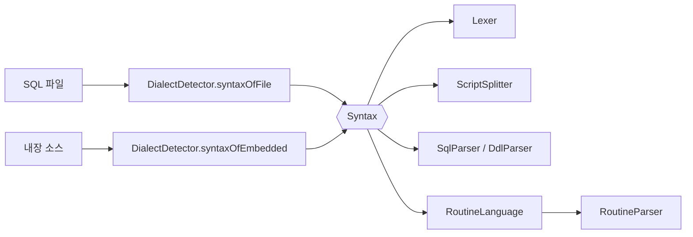

# F-019 PostgreSQL 지원 설계

## 1. 접근 방식
파서는 지금처럼 하나로 두고, 텍스트를 읽기 전에 "읽기 방식"을 정해 렉서부터 루틴 파서까지 넘긴다([ADR-0012](../../decisions/0012-pass-sql-syntax-to-parsers.md)). 순서는 셋이다.

1. **판정과 선택**: PostgreSQL을 알아보고(F-019-R2·R3) 대상 방언으로 순위에 넣는다(R1·R4·R5).
2. **통로**: 읽기 방식 `Syntax`와 루틴 언어 `RoutineLanguage`를 만들고 기존 불리언 둘을 바꾼다(R6·R7). 이 단계는 동작을 바꾸지 않는다(R8).
3. **문법**: PostgreSQL 표기를 렉서·분할기(R9~R11), DML(R12~R17), DDL(R18~R23), 루틴(R24~R31) 순으로 더한다. 겹치는 표기와 PostgreSQL에만 있는 문장은 `Syntax.POSTGRES`에서만 켠다.

## 2. 구성 요소와 변경 범위

| 구성 요소 | 변경 내용 | 관련 요구사항 |
|---|---|---|
| core `spi/Dialect` | `POSTGRES` 추가. `parse`가 `postgres`·`postgresql`·`pgsql`을 읽는다 | R1 |
| core `scan/FileClassifier` | SQL 확장자에 `pgsql` 추가 | R2 |
| sql `lexer/Syntax` (새로) | `DEFAULT`, `MYSQL`, `POSTGRES` | R6 |
| sql `lexer/Lexer` | `boolean mysql` → `Syntax`. PostgreSQL: 달러 인용(토큰이 `$`로 시작할 때), `E''`, `$n`, 연산자, `#`을 이름 글자로 보지 않음 | R6, R9, R10 |
| sql `script/ScriptSplitter` | `Syntax` 전달. `COPY … FROM stdin` 데이터 구간, psql 메타 명령 | R9, R11 |
| sql `parser/SqlParser`, `DdlParser` | 생성자에 `Syntax`. PostgreSQL DML·DDL 문법 | R12~R23 |
| sql `parser/RoutineLanguage` (새로), `RoutineParser` | `boolean sqlPl` → `RoutineLanguage`. PL/pgSQL 문장 | R25 |
| sql `script/RoutineHeader`, `routine/RoutineBodyHandler`, `BodyWalker`, `DynamicSql` | PostgreSQL 루틴 헤더와 달러 인용 본문, `language` 값, `PERFORM`·`EXECUTE`·`RETURN QUERY`, 트리거·`DO`·`LANGUAGE sql` | R24~R31 |
| sql `analysis/DialectDetector` | PostgreSQL 내용 특징과 토큰 점수, 읽기 방식을 정하는 한곳(`syntaxOfFile`, `syntaxOfEmbedded`) | R2, R3, R7 |
| sql `analysis/DialectTokens`, `DialectSelection`, `SqlAnalyzer` | 대상 방언 목록과 순위, `oracle`/`db2` 이분 분기를 셋으로 | R4, R5 |
| sql `analysis/FactExtractor`, `StatementFacts`, `routine/Builtins`, `DataLoadGrouper` | 시스템 카탈로그, `EXCLUDED`, 시퀀스 함수, 내장 함수, `COPY` 적재 | R12, R16, R17, R23, R27 |
| mybatis `DialectVariants`, `MyBatisAnalyzer` | 대상 방언 목록과 순위, 내장 소스 `attrs.dialect` | R32 |
| springxml `BatchGraphWriter` | `A.B` 해석에 `POSTGRES` | R33 |
| cli `AnalyzeCommand`, `Hints` | 사용법, 오류 문구, 방언 표와 안내 | R34 |
| link 관계 추론의 타입 비교 | PostgreSQL 타입 별칭 | R35 |
| `samples/sample-pg`, cli `verify/SamplePgIT` | 샘플과 정답 대조 | R36 |

## 3. 데이터 모델
그래프 계약([F-001 design.md](../F-001-analysis-pipeline/design.md))에 더하는 것은 값뿐이고 노드·엣지 종류는 그대로다.

- 노드 `dialect`: `ORACLE`, `DB2`에 `POSTGRES`를 더한다.
- 루틴 `language`: `PLSQL`, `SQLPL`에 `PLPGSQL`, `SQL`을 더한다.
- `DB_TABLE.partitionOf`: 파티션의 부모 테이블 이름(정규화한 이름). 파티션이 아니면 키가 없다.
- `project.options.dialect`: `POSTGRES`가 올 수 있다.
- 데이터 적재 묶음: `COPY … FROM stdin`도 같은 노드와 attrs(`dataLoad`, `rowCount`)를 쓴다.

## 4. 인터페이스

```java
// sql 모듈 안. 한 텍스트를 읽는 규칙(ADR-0012)
package io.codeatlas.sql.lexer;
public enum Syntax { DEFAULT, MYSQL, POSTGRES }

// 루틴 본문의 언어
package io.codeatlas.sql.parser;
public enum RoutineLanguage { PLSQL, SQLPL, PLPGSQL }
```

- `Lexer.tokenize(String sql, Syntax syntax)`, `tokenizeAt(.., Syntax)`, `stream(.., Syntax)`. 인자 없는 꼴은 `DEFAULT`다. `boolean mysql`을 받던 꼴은 없앤다.
- `ScriptSplitter.forEach(text, sink, tokenListener, Syntax)`, `splitEmbedded(text, Syntax)`, `shapeOf(text, Syntax)`.
- `new SqlParser(tokens, Syntax)`, `new DdlParser(tokens, Syntax)`. 토큰만 받는 생성자는 `DEFAULT`로 남긴다(기존 테스트가 쓴다).
- `new RoutineParser(tokens, RoutineLanguage)`.
- `DialectDetector.syntaxOfFile(pathToken, optionDialect, text, projectSyntax)`와 `syntaxOfEmbedded(attrsDialect, projectSyntax, text)`가 읽기 방식을 정한다. 다른 곳에서 따로 정하지 않는다.
- 달러 인용 본문은 문자열 토큰 하나로 온다. 루틴 본문으로 읽을 때는 그 토큰의 안쪽을 원문 위치(`Lexer.tokenizeAt`)에 맞춰 다시 토큰으로 만든다. 그래서 본문 구문의 위치가 원본 파일 기준이다(R25).

명령줄: `--dialect oracle|db2|postgres|auto`.

## 5. 흐름



## 6. 검토한 대안
| 대안 | 채택하지 않은 이유 |
|---|---|
| 방언을 넘기지 않고 합집합 문법에 더함 | ADR-0012. `$$`·`#`를 추측으로 갈라야 한다 |
| 방언별 파서를 따로 두고 라우팅 | ADR-0012. 공통 문법과 복구 규칙을 방언 수만큼 유지해야 한다 |
| `Syntax` 대신 core의 `Dialect`를 그대로 넘김 | `Dialect`에는 MySQL이 없고(대상 방언이 아니다) `AUTO`가 있다. 읽는 규칙과 사용자가 고르는 대상 방언은 다른 것이다 |
| sample-shop에 PostgreSQL DDL을 더함 | 방언 여러 벌 선택이 끼어들어 기존 정답과 진단이 달라진다 |
| 파티션을 부모 테이블에 접어 넣음 | 파티션을 직접 가리키는 SQL이 "DDL에 없는 테이블"이 된다 |

## 7. 위험과 미확정 사항
- 읽기 방식을 잘못 정하면 그 텍스트 전체를 다른 규칙으로 읽는다. 경로·설정·옵션에 표시가 없는 프로젝트의 평범한 매퍼 구문은 기본 읽기 방식으로 읽는데, 겹치는 표기(`#`, `$$`)가 없는 구문은 어느 쪽으로 읽어도 결과가 같다.
- sql과 mybatis의 방언 표를 함께 고쳐야 한다(ADR-0010의 기존 부담). 양쪽 표 테스트로 막는다.
- [확인 필요] 실제 PostgreSQL 프로젝트(공개 프로젝트)로 한 검증은 하지 않았다. `~/workspace/codeatlas-corpus`에 PostgreSQL을 쓰는 프로젝트가 있으면 돌려 본다.
- [확인 필요] pg_dump 버전에 따른 출력 차이(옛 버전의 `WITH OIDS`, `SET default_with_oids`).
