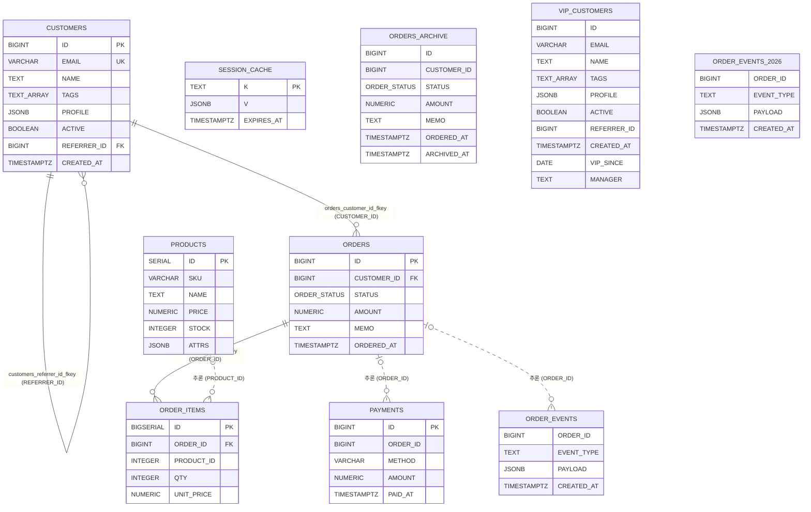

# 기대 ERD

샘플의 DDL(`db/01_schema.sql`)과 SQL 조인 조건에서 나와야 하는 테이블 관계다.
실선은 DDL 의 FK 제약, 점선은 FK 제약 없이 조인 조건에서 추론한 관계다. 방향은 부모(1) → 자식(N).
추론한 관계는 제약이 없어 부모 행이 반드시 있는지 알 수 없으므로 부모 쪽을 "0 또는 1"(`|o`)로 적는다.
JSON 으로 된 같은 내용은 `must-have-edges.json` 의 `REFERENCES` 항목(`attrs.source` 가 `DDL` 또는 `INFERRED`)에 있다.
이름은 대문자로 정규화되고 스키마(`public`)는 빠진다.

Mermaid 는 타입 자리에 공백·괄호·대괄호를 받지 않아 타입을 줄여 적었다(`TIMESTAMP WITH TIME ZONE` → `TIMESTAMPTZ`, `TEXT[]` → `TEXT_ARRAY`, `CHARACTER VARYING(n)` → `VARCHAR`). 정확한 타입 표기는 `must-have-nodes.json` 의 `dataType` 에 있다.

## DDL 의 외래 키 (`source=DDL`)

모두 `db/01_schema.sql` 끝의 `ALTER TABLE ONLY ... ADD CONSTRAINT ... FOREIGN KEY` 다.

| 자식 | 컬럼 | 부모 | 컬럼 | 제약 | 줄 | 딸린 절 |
|---|---|---|---|---|---|---|
| CUSTOMERS | REFERRER_ID | CUSTOMERS | ID | customers_referrer_id_fkey | 458 | `ON DELETE SET NULL` (자기 참조) |
| ORDER_ITEMS | ORDER_ID | ORDERS | ID | order_items_order_id_fkey | 466 | `ON DELETE CASCADE NOT VALID` |
| ORDERS | CUSTOMER_ID | CUSTOMERS | ID | orders_customer_id_fkey | 474 | `ON UPDATE CASCADE DEFERRABLE INITIALLY DEFERRED` |

## 조인에서 추론한 관계 (`source=INFERRED`)

"FK 제약이 없고, 자식 컬럼이 부모의 단일 컬럼 PK 전체와 등치 조인"인 경우만 넣었다(sample-shop 과 같은 기준).

| 자식 | 컬럼 | 부모 | 컬럼 | 근거 구문 | 비고 |
|---|---|---|---|---|---|
| ORDER_ITEMS | PRODUCT_ID | PRODUCTS | ID | `OrderMapper.selectProductStats` | 자식 `integer`, 부모 `serial`. 같은 타입으로 봐야 한다(`typeMismatch` 없음, F-019-R35) |
| PAYMENTS | ORDER_ID | ORDERS | ID | `OrderMapper.deleteCancelledPayments`(DELETE ... USING), `OrderMapper.markPaidOrders`(CTE 안의 UPDATE ... FROM) | DDL 에는 주석 처리된 ALTER 만 있다(479~480행) |
| ORDER_EVENTS | ORDER_ID | ORDERS | ID | 함수 `ORDER_TIMELINE` 의 `RETURN QUERY`(`db/02_routines.sql` 145행) | 근거가 루틴 본문에만 있다. 부모가 파티션 테이블의 부모다 |

## 관계가 없어야 하는 것

| 대상 | 이유 |
|---|---|
| ORDER_EVENTS_2026 | 파티션. 부모의 컬럼만 물려받는다. 파티션을 직접 조인하는 구문이 없으므로 관계가 없다 |
| ORDERS_ARCHIVE | `LIKE` 는 컬럼 정의만 복사한다. 원본의 FK(orders → customers)를 따라 만들지 않는다. 조인하는 구문도 없다 |
| VIP_CUSTOMERS | `INHERITS` 는 FK 를 물려주지 않는다. 조인하는 구문도 없다 |
| SESSION_CACHE | 조인하는 구문이 없다 |

## 판단을 미룬 관계 (정답에 넣지 않음)

| 조인 | 위치 | 미룬 이유 |
|---|---|---|
| CUSTOMERS.ID = (CTE paid).CUSTOMER_ID | `OrderMapper.markPaidOrders` 의 둘째 CTE | CTE 의 컬럼을 원본 테이블(ORDERS.CUSTOMER_ID)로 풀어 조인으로 기록할지는 구현에 달렸다. 풀더라도 같은 컬럼 대응의 DDL FK 가 있어 추론 관계는 새로 생기지 않는다 |
| CUSTOMERS.REFERRER_ID = (CTE tree).ID | `CustomerMapper.selectReferralTree` 의 재귀 항 | 위와 같다. 풀면 DDL 의 자기 참조 FK 와 같은 대응이다 |
| ORDERS.CUSTOMER_ID = CUSTOMERS.ID (LATERAL) | `CustomerMapper.selectLatestOrders` | `must-have-edges.json` 에 `JOINS` 를 `certainty: low` 로 넣었다. DDL FK 와 같은 대응이라 ERD 는 달라지지 않는다 |
| 뷰 V_ORDER_SUMMARY 와의 관계 | `CustomerMapper.selectOrderSummary` | 뷰가 낀 조인은 기본으로 관계를 만들지 않는다(F-018-R11). 이 구문에는 조인도 없다 |
