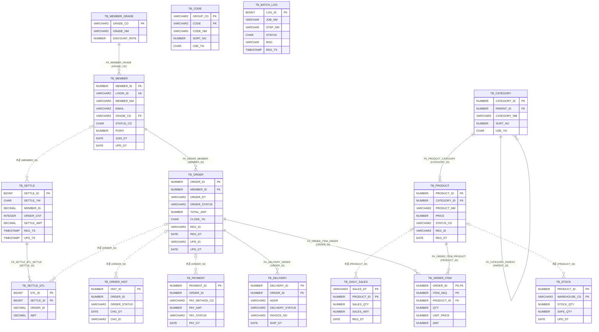

# 기대 ERD

샘플의 DDL(`db/oracle`, `db/db2`)과 SQL 조인 조건에서 나와야 하는 테이블 관계다.
실선은 DDL 의 FK 제약, 점선은 FK 제약 없이 조인 조건에서 추론한 관계다. 방향은 부모(1) → 자식(N).
추론한 관계는 제약이 없어 부모 행이 반드시 있는지 알 수 없으므로 부모 쪽을 "0 또는 1"(`|o`)로 적는다.
JSON 으로 된 같은 내용은 `must-have-edges.json` 의 `REFERENCES` 항목(`attrs.source` 가 `DDL` 또는 `INFERRED`)에 있다.

## 테이블 (16개)

| 테이블 | 출처 | 비고 |
|---|---|---|
| TB_MEMBER_GRADE, TB_MEMBER, TB_CATEGORY, TB_PRODUCT, TB_STOCK, TB_ORDER_ITEM, TB_PAYMENT, TB_DELIVERY, TB_ORDER_HIST, TB_DAILY_SALES | `db/oracle/01_tables.sql` | |
| TB_ORDER, TB_CODE | `db/oracle/01_tables.sql` | `SHOP.` 스키마를 붙여 생성. ID 는 스키마 없이 `db:table:TB_ORDER`, `attrs.schema = SHOP` |
| TB_BATCH_LOG | `db/db2/01_tables.sql` | `BATCH.` 스키마, IDENTITY 컬럼. 관계 없음 (고립) |
| TB_SETTLE, TB_SETTLE_DTL | `db/db2/01_tables.sql` | DB2 |
| TB_HOLIDAY | DDL 없음 | `BatchMapper.selectIsHoliday` 에서만 참조. `declared=false`. 컬럼과 관계를 알 수 없으므로 그림에는 넣지 않았다. ERD 에 "정의 없는 테이블"로 따로 표시되면 된다 |

뷰 2개(`VW_ORDER_SUMMARY`, `VW_PRODUCT_STOCK`)와 시노님 2개(`SYN_ORDER`, `SYN_CODE`)는 테이블이 아니다. ERD 의 테이블 상자로 나오면 안 된다.

## DDL 의 FK (8개, 전부 나와야 한다)

| 자식 | 컬럼 | 부모 | 컬럼 | 제약 이름 | 선언 형태 |
|---|---|---|---|---|---|
| TB_CATEGORY | PARENT_ID | TB_CATEGORY | CATEGORY_ID | FK_CATEGORY_PARENT | CREATE TABLE 안, 컬럼 수준 인라인 (자기 참조) |
| TB_ORDER | MEMBER_ID | TB_MEMBER | MEMBER_ID | FK_ORDER_MEMBER | CREATE TABLE 안, 테이블 수준 |
| TB_ORDER_ITEM | ORDER_ID | TB_ORDER | ORDER_ID | FK_ORDER_ITEM_ORDER | CREATE TABLE 안, `REFERENCES SHOP.TB_ORDER`, ON DELETE CASCADE |
| TB_MEMBER | GRADE_CD | TB_MEMBER_GRADE | GRADE_CD | FK_MEMBER_GRADE | ALTER TABLE (여러 줄) |
| TB_PRODUCT | CATEGORY_ID | TB_CATEGORY | CATEGORY_ID | FK_PRODUCT_CATEGORY | ALTER TABLE |
| TB_ORDER_ITEM | PRODUCT_ID | TB_PRODUCT | PRODUCT_ID | FK_ORDER_ITEM_PRODUCT | ALTER TABLE ... ADD ( CONSTRAINT ... ) |
| TB_DELIVERY | ORDER_ID | TB_ORDER | ORDER_ID | FK_DELIVERY_ORDER | ALTER TABLE, `REFERENCES SHOP.TB_ORDER` |
| TB_SETTLE_DTL | SETTLE_ID | TB_SETTLE | SETTLE_ID | FK_SETTLE_DTL_SETTLE | DB2 CREATE TABLE 안 |

## 추론 관계 (6개, 전부 나와야 한다)

FK 제약이 없고, 자식의 컬럼이 부모의 **단일 컬럼 PK 전체**와 등치 조인되는 경우만 넣었다. 방향은 "PK 쪽이 부모"로 정했다.

| 자식 | 컬럼 | 부모 (PK) | 근거 조인 |
|---|---|---|---|
| TB_PAYMENT | ORDER_ID | TB_ORDER (ORDER_ID) | `OrderMapper.deleteOrder`, `orderDao.updateOrderByPayment`, `settleDao.selectSettleTargets` (CTE 안) |
| TB_STOCK | PRODUCT_ID | TB_PRODUCT (PRODUCT_ID) | `ProductMapper.selectProductList`, `selectLowStockProducts`, 뷰 `VW_PRODUCT_STOCK` 정의 |
| TB_ORDER_HIST | ORDER_ID | TB_ORDER (ORDER_ID) | `orderDao.selectOrderHistory` |
| TB_DAILY_SALES | PRODUCT_ID | TB_PRODUCT (PRODUCT_ID) | `BatchMapper.selectDailySalesReport` |
| TB_SETTLE | MEMBER_ID | TB_MEMBER (MEMBER_ID) | `settleDao.selectSettleList` |
| TB_SETTLE_DTL | ORDER_ID | TB_ORDER (ORDER_ID) | DB2 프로시저 `SP_SETTLE_MONTHLY` 80행 (매퍼에는 없고 프로시저 본문에만 있다) |

## 나오면 안 되는 관계

| 관계 | 이유 |
|---|---|
| TB_PAYMENT → TB_ORDER 가 **DDL 출처**로 | `02_constraints_indexes.sql` 25행의 ALTER TABLE 은 주석이다. 추론으로만 나와야 한다 |
| TB_ORDER → TB_PAYMENT, TB_PRODUCT → TB_STOCK, TB_MEMBER → TB_ORDER | 방향이 반대다 |
| TB_ORDER → TB_ORDER | `CK_ORDER_CLOSE_YN` 은 CHECK 제약이다 |
| TB_ORDER_OLD, TB_ORDER_BAK 이 낀 관계 | 주석 속의 DDL 이다 |
| ORDER_SUM, PAY_SUM, T, X, D, PAGE_T, DUAL, SYSDUMMY1 이 낀 관계 | CTE 이름, 별칭, 더미 테이블이다 |

## 판단을 미룬 관계 (있어도 없어도 된다)

아래는 등치 조인이 있지만 위 기준(부모의 단일 컬럼 PK 전체와 조인)에 맞지 않아 정답에 넣지 않았다. JOINS 엣지는 있어야 하지만 REFERENCES 로 올릴지는 분석기의 추론 규칙에 달렸다.

| 조인 | 넣지 않은 이유 |
|---|---|
| TB_ORDER.ORDER_STATUS = TB_CODE.CODE, TB_ORDER_HIST.ORDER_STATUS = TB_CODE.CODE, TB_PAYMENT.PAY_METHOD_CD = TB_CODE.CODE | TB_CODE 의 PK 는 (GROUP_CD, CODE) 복합이고, GROUP_CD 는 상수 조건이다 |
| TB_ORDER_HIST.ORDER_ID = TB_ORDER_ITEM.ORDER_ID (`OrderMapper.selectOrderItems` 의 상관 서브쿼리) | 양쪽 모두 PK 전체가 아니다 (둘 다 TB_ORDER 를 가리키는 형제 관계) |
| TB_DAILY_SALES.PRODUCT_ID = TB_ORDER_ITEM.PRODUCT_ID (`BatchMapper.mergeDailySales`, 인라인 뷰를 거친다) | 양쪽 모두 PK 전체가 아니다. 인라인 뷰의 컬럼 계보를 따라가야 보인다 |
| TB_CATEGORY 의 `CONNECT BY PRIOR C.CATEGORY_ID = C.PARENT_ID` | 이미 DDL FK(FK_CATEGORY_PARENT)가 있다 |
| TB_DELIVERY ↔ TB_ORDER 를 1:1 로 볼지 | `UX_DELIVERY_01` 유니크 인덱스가 있어 실제로는 1:0..1 이다. 그림에는 1:N 으로 그렸다 |
